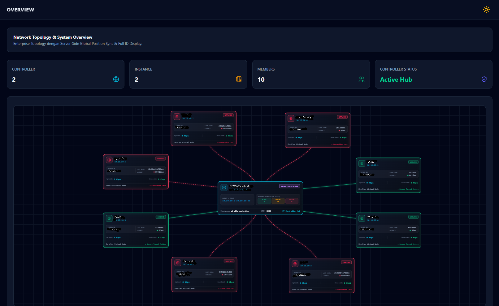
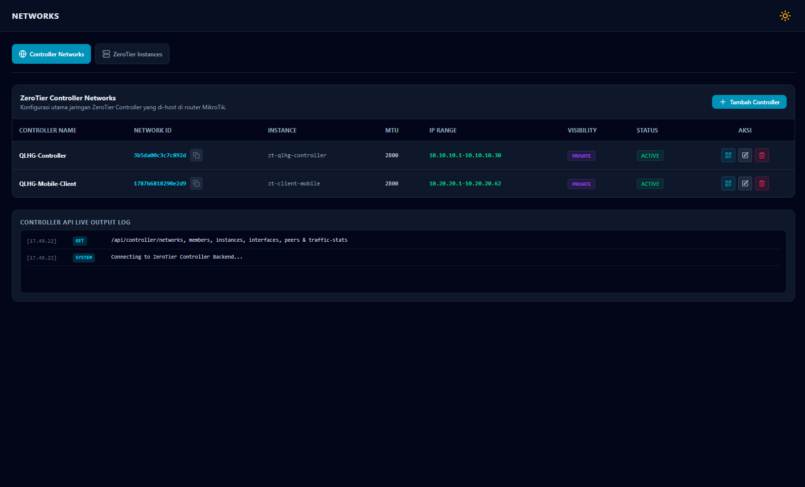
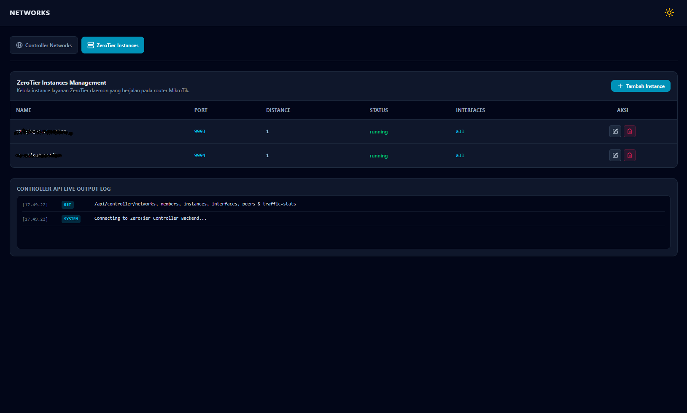
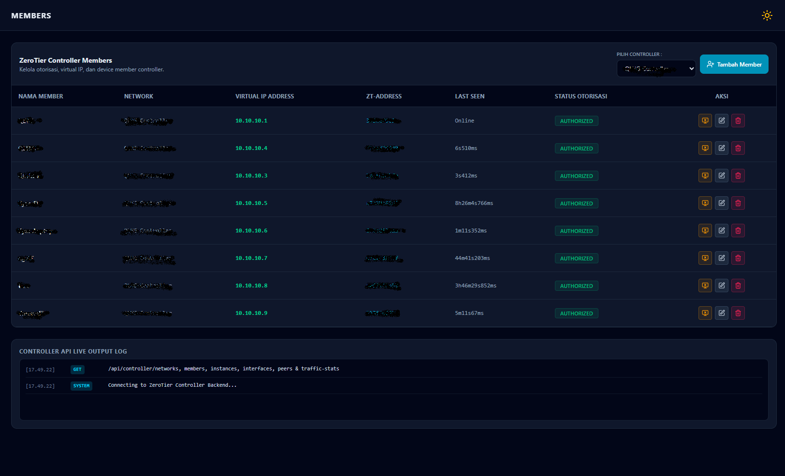
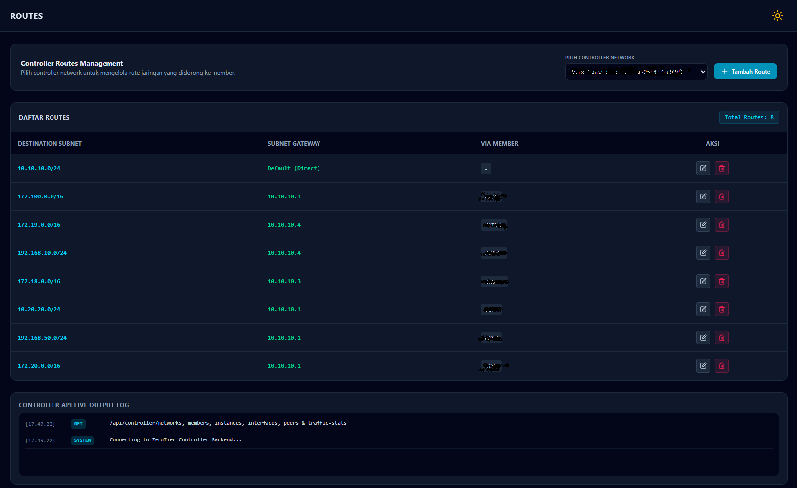
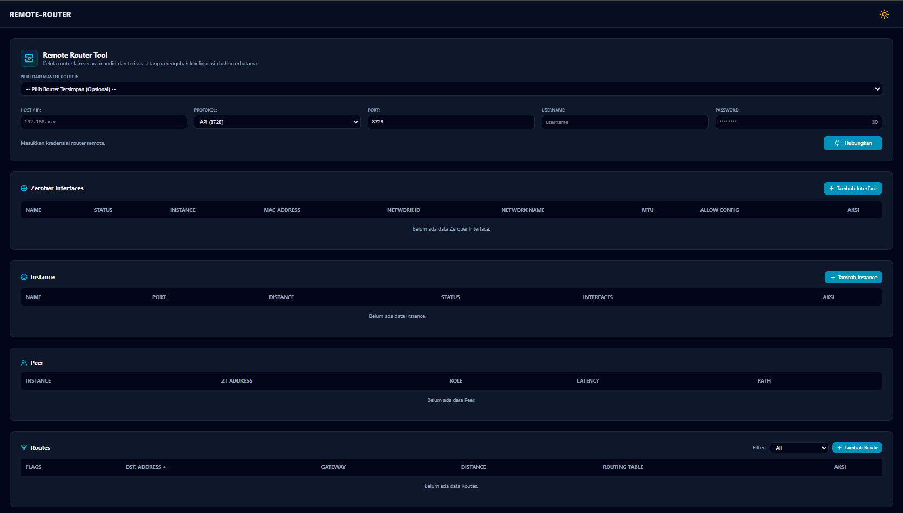
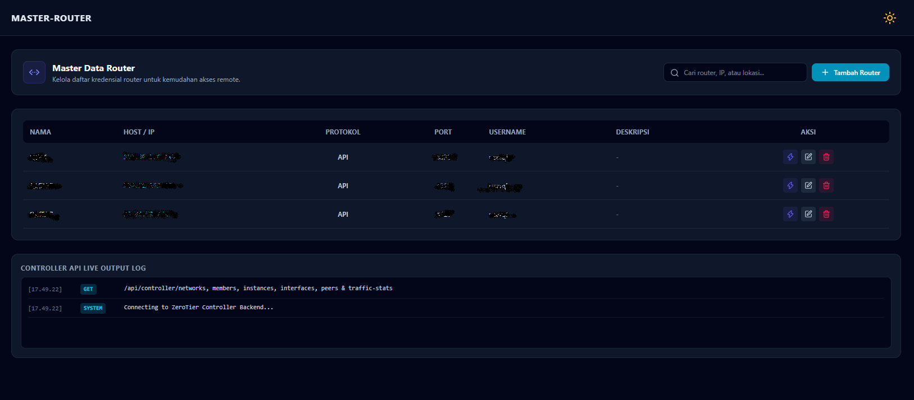
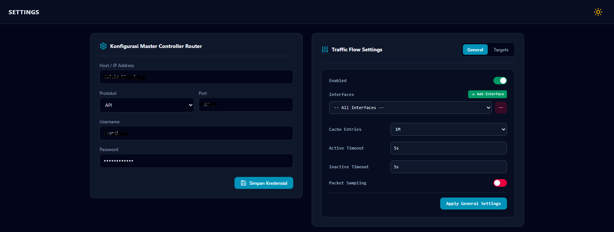
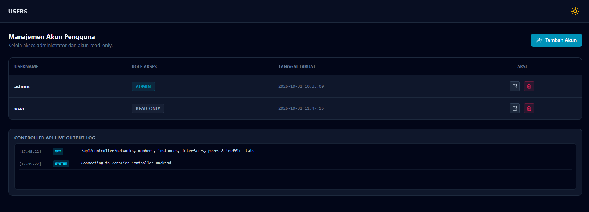

# ZeroDash: Dasbor Manajemen MikroTik ZeroTier Controller & Traffic Flow

**ZeroDash** adalah dasbor manajemen berbasis web yang modern dan terpusat, dirancang khusus untuk administrator jaringan yang menggunakan router MikroTik dengan layanan **ZeroTier Controller** dan **Traffic Flow (IPFIX/NetFlow)**. 

Dibangun dengan antarmuka bertema *Winbox* yang elegan (mendukung mode gelap dan terang), menggunakan **Tailwind CSS** dan **Alpine.js**, ZeroDash memberikan kemudahan luar biasa untuk mengelola jaringan virtual (*Software-Defined Network*) serta telemetri lalu lintas jaringan tanpa harus repot mengingat atau mengetik perintah CLI terminal yang rumit.

---

## 🚀 Fitur & Kemampuan Utama

### 1. ZeroTier Controller Management
* **Manajemen Instance & Jaringan:** Buat dan kelola *instance* ZeroTier beserta jaringan virtual (*Controller Networks*) langsung di router. Atur MTU, rentang IP, dan privasi jaringan.
* **Manajemen Member Lengkap:** Otorisasi perangkat, berikan IP Virtual, dan pantau status *Last Seen* (mendukung deteksi *direct connection* untuk macOS/Linux).
* **Routing Terpusat:** Distribusikan rute (*subnet* & *gateway*) antar perangkat secara dinamis.
* **Multi-Controller Dropdown Filter:** Saring data member dan rute berdasarkan spesifik jaringan (*Network ID*) jika router Anda menangani lebih dari satu *controller*.
* **Ekspor QR Code:** Hasilkan QR Code *Network ID* berbingkai rapi untuk kemudahan *join* perangkat *mobile*.

### 2. MikroTik Traffic Flow & Remote Router Tool
* **Traffic Flow (Gaya Winbox):** Aktifkan IPFIX/NetFlow, atur durasi *timeout*, kapasitas *cache*, dan antarmuka jaringan yang dipantau.
* **Target Editor Lanjutan:** Kirim data telemetri ke server kolektor *NetFlow* dengan dukungan pengaturan IP, port, dan versi (v5/v9).
* **Remote Router Tool:** Akses dan kelola router MikroTik cabang (*Remote*) secara mandiri dari satu pintu tanpa mengubah konfigurasi Master.

---

## 💻 Teknologi yang Digunakan

* **Backend:** Node.js, Express.js, MikroTik RouterOS API.
* **Frontend:** EJS (Embedded JavaScript), Tailwind CSS, Alpine.js, Lucide Icons.

---

## 📦 Panduan Instalasi & Menjalankan Aplikasi

Pastikan Anda memiliki **Node.js** terinstal di server/komputer Anda.

1. **Clone Repository:**
   ```bash
   git clone https://github.com/deepstruct-ilyasa/zerodash.git
   cd zerodash
   ```
2. **Instal Dependensi:**
   ```bash
   npm install
   ```
3. **Konfigurasi Environment:**
   Buat file `.env` dari template yang disediakan dan sesuaikan *port* atau pengaturan rahasia Anda.
   ```bash
   cp .env.example .env
   ```
4. **Jalankan Aplikasi:**
   * Mode Pengembangan (Dev): `npm run dev`
   * Mode Produksi: `npm start`
5. **Akses Dasbor:** Buka browser dan arahkan ke `http://<ip-server-anda>:<port>`.

---

## 📖 Panduan Penggunaan & Navigasi Menu

Berikut adalah penjelasan detail fungsi dari setiap menu yang ada di *sidebar* ZeroDash dan cara penggunaannya:

### 1. Overview (Topologi Jaringan)

* **Fungsi:** Menyajikan visualisasi *Network Topology* secara *real-time*. Anda dapat melihat hubungan antar Master Controller dengan seluruh perangkat (*node*) yang terhubung, lengkap dengan indikator status aktif/nonaktif dan metrik ringkas.
* **Cara Pakai:** Cukup buka menu ini untuk melakukan pemantauan grafis. Node berwarna hijau menandakan koneksi sehat/aktif, sementara merah menandakan *offline* atau *connection lost*.

### 2. Controller Networks & Instances
Menu ini memiliki dua sub-tab utama: **Controller Networks** dan **ZeroTier Instances**.

#### A. Controller Networks

* **Fungsi:** Tempat utama membuat jaringan ZeroTier. 
* **Cara Pakai:** Klik **+ Tambah Controller** untuk membuat jaringan baru. Tentukan *IP Range* (misal: `10.10.10.1-10.10.10.30`). Anda bisa menyalin *Network ID* dengan mengeklik ikon *copy*, atau mengeklik ikon **QR Code** untuk menampilkannya di layar dan mengunduhnya untuk perangkat *mobile*.

#### B. ZeroTier Instances

* **Fungsi:** Mengelola layanan perangkat lunak (*daemon*) ZeroTier di router Anda.
* **Cara Pakai:** Di tab ini, Anda bisa menambah instance baru, menentukan *Port* UDP (default: `9993`), dan mengatur *interfaces* mana saja yang diizinkan untuk lalu lintas ZeroTier.

### 3. Controller Members

* **Fungsi:** Mengontrol siapa saja yang boleh masuk ke jaringan virtual Anda.
* **Cara Pakai:** 
  * Gunakan **Dropdown Filter** di pojok kanan atas untuk memilah perangkat berdasarkan jaringan/controller tertentu.
  * Klik tombol **AUTHORIZE** (ikon monitor) pada kolom *Aksi* untuk mengizinkan perangkat bergabung. Status akan berubah menjadi hijau.
  * Klik ikon *Edit* untuk memberikan **Virtual IP Address** statis kepada member agar mudah diingat.

### 4. Controller Routes

* **Fungsi:** Mendorong (*push*) aturan rute ke semua member agar mereka tahu cara mencapai *subnet* LAN di belakang router atau perangkat tertentu.
* **Cara Pakai:** 
  1. Pilih *Controller Network* dari dropdown di atas.
  2. Klik **+ Tambah Route**.
  3. Masukkan *Destination Subnet* (misal: `192.168.50.0/24`) dan *Gateway* (IP Virtual ZT dari router yang memiliki jaringan tersebut).

### 5. Remote Router Tool

* **Fungsi:** Utilitas canggih untuk me-remote router MikroTik cabang. Sangat berguna jika Anda ingin mengecek antarmuka ZeroTier atau status Peer di router cabang tanpa mengubah setelan utama dasbor.
* **Cara Pakai:** Masukkan IP, *port* API, beserta username & password router cabang Anda, lalu klik **Hubungkan**. Data *Interfaces*, *Instance*, dan *Peer* dari router cabang tersebut akan langsung ditarik dan bisa Anda kelola dari halaman ini.

### 6. Master Router (Daftar Router Tersimpan)

* **Fungsi:** Buku alamat (*address book*) untuk menyimpan kredensial router-router yang sering Anda akses.
* **Cara Pakai:** Tambahkan data router cabang atau router klien Anda di sini. Data yang disimpan di sini dapat dipanggil dengan cepat melalui fitur *dropdown* opsional pada menu **Remote Router Tool** agar Anda tidak perlu mengetik ulang kata sandi berkali-kali.

### 7. Settings (Konfigurasi Inti Dasbor)

Halaman ini adalah pusat konfigurasi komunikasi backend aplikasi Anda. Terdapat dua bagian:
* **Konfigurasi Master Controller Router:** Masukkan kredensial (IP, API Port, User, Pass) dari router MikroTik utama Anda yang bertindak sebagai *Master ZeroTier Controller*. Klik **Simpan Kredensial** agar seluruh dasbor bisa berfungsi.
* **Traffic Flow Settings (General & Targets):** Aktifkan sakelar *Enabled* untuk menyalakan fitur pelaporan trafik IPFIX. Pindah ke tab **Targets** jika Anda memiliki server pemantau jaringan (seperti PRTG atau NetFlow Analyzer) dan masukkan IP-nya ke sana.

### 8. Manajemen Akun (Users)

* **Fungsi:** Membatasi siapa saja yang bisa mengubah konfigurasi jaringan.
* **Cara Pakai:** Anda bisa membuat akun dengan hak akses `ADMIN` (dapat menambah/menghapus konfigurasi) atau `READ_ONLY` (hanya bisa memantau/melihat data tanpa bisa mengubah pengaturan).

---

## 🤝 Kontribusi

Kami sangat mengapresiasi kontribusi Anda! Jika Anda menemukan kutu (*bug*), memiliki ide fitur baru, atau ingin memperbaiki dokumentasi, silakan buka *Issue* atau kirimkan *Pull Request*.